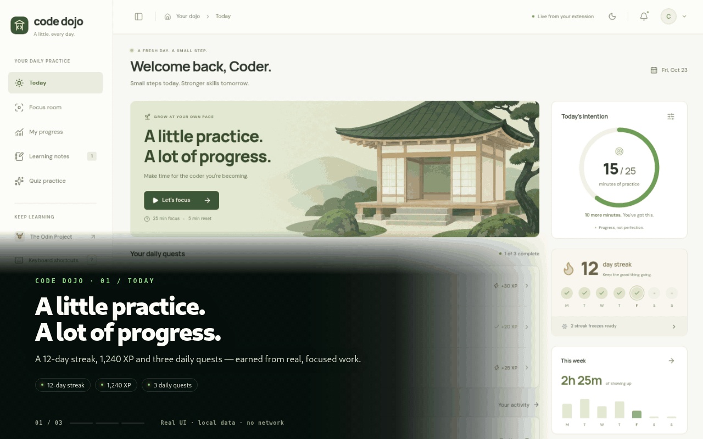
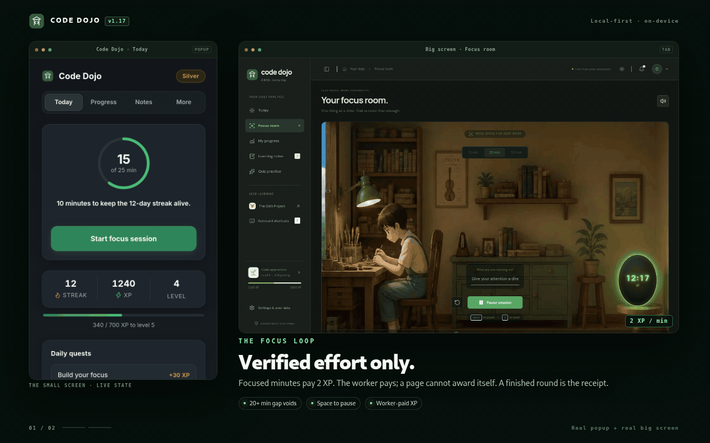

# Code Dojo — Daily Coding Practice

A Chrome extension that applies **Duolingo's habit mechanics to learning to code**:
streaks, XP, levels, leagues, daily quests, reminders — and it learns **when you
usually code** from your real practice on the Odin Project.

The rule it enforces: a little practice every day beats a lot sometimes.

## Demo

*The 12-second tour: the real big screen in light and dark, the focus room, and learning notes.*

*The proof: the popup and the big screen together — worker-paid focus sessions and on-device note review.*

• v1.17: One focus surface. Small timer page removed; #focus on the big screen runs the session (start, pause, reset, live tab title). 20+ min gap voids a round; closed tabs return paused. Workers pay completed rounds. Suite: 73 checks (bash tests/run.sh).
• v1.16: Popup redesigned in Dark Zen (slate canvas, translucent cards, hairline borders, bundled Inter, green hero button, gold rewards). No markup/behavior changes.
• v1.15: Big screen raid/medal shelf mirrors real small-screen stats (single ledger). Boss HP derives from live stats. Worker backs two capped daily rewards: +5 XP for first 3 correct syntax drills (no streak impact) and the daily strike claim. Suite: 72 checks.
• v1.14: Big screen gets "Night Zen" workspace (themes, ambient sounds); opens as a plain tab by default.
• v1.11: Streak reliability fixes. Freezes now actually save streaks instead of consuming and resetting. One missed day burns exactly one freeze. Backward clock jumps re-anchor instead of resetting. Guarded by dependency-free, Chromium-only suite: 70 checks.
• v1.10: XP scaling cap. 2 XP/min up to stretch threshold, then 1 XP/min (worker-enforced). Settings adds Export/Import JSON and two-step Reset. Popup matches Focus Tracker (Dojo green, 4 tabs: Today/Progress/Notes/More, second-lap goal ring, quiz door on Today).
• v1.9: Unified AI script (ai.js) forces English output via expectedInputs/expectedOutputs. Stricter grading: Grader references lesson code/headings; answers need strict shape (verdicts only, 1-sentence quote) with one retry. Notes capped by text length.
• v1.8: Notes act as mini-learning exercises. Gemini Nano runs 4 yes/no checks (+5 XP each, max 20). Provides 1 comment and a rewrite comparison; allows one rewrite to earn the difference. Near-duplicates pay nothing; 2-note daily cap. No model fallback: 5 XP base.
• v1.7: Strict quiz rules. Blank/short answers auto-fail. Scale: Correct 25 XP / Partial 10 XP / Wrong 0 XP (max 3 paying daily). Flawed answers queue for tomorrow. Focus session matches note value (20 XP). Adds stretch ring, end-of-round quiz prompts, and smart reminders.
• v1.6: Quizzes decouple from strict assumptions; adds editable "Quiz me on" field for custom topics (VS Code, articles) or blank starts.
• v1.5: On-device Odin Project quizzes via Chrome Gemini Nano. Generates 3 local questions using page text, code blocks, and recent notes.
• v1.4: Focus page upgrades: countdown ring, 5-minute break timer, hotkeys (Space/R/1-3), favicon countdown, and screen wake lock. Adds level-up confetti and toast alerts.
• v1.3–v1.2: Focus sessions must be continuous (20+ min gap voids). Adds "Coding elsewhere" mode for VS Code tracking. Generic quizzes removed in v1.2, replaced by contextual v1.5 quizzes.

## What's inside

| Duolingo mechanic | Here |
|---|---|
| 🔥 Streak | Practiced your daily goal today? Streak +1. Miss a day → a **streak freeze** covers you once (you earn more at every 7th day). **A learning note also counts as the day's activity** — a VS Code day with a written note never loses the streak. |
| ⚡ XP | **Verified effort pays the most**: +2 per focused minute, quiz answers pay by verdict (correct 25, partial 10, wrong 0), +10 daily-goal bonus, quest rewards. Learning notes are a small capped garnish: a **reviewed note pays by its checks** (5 XP each, max 20, 2 a day). No points for anything you didn't actually do. |
| 📝 Learning log | In the popup: write *what you figured out* in a multi-line box (it grows as you type). The **on-device model reviews it** against four checks — names a concept, own words, has an example, flags what's unsure — gives **one specific comment** and a **suggested rewrite to compare** (your text is never replaced). **Code computes the points**: +5 per check passed, max 20, capped at **2 paying notes a day**. Short notes **cap their own checks** (a 2-word fragment can count at most one). Near-duplicates of an earlier note pay nothing. **Rewrite once to earn the difference.** No model? A 5 XP base. Feeds a daily quest too. |
| 📈 Levels | Level 1 → ∞. Needs 100·(n−1)² XP, so early levels fly by and later ones demand real work. |
| 🏆 Leagues | Bronze → Silver → Gold → Platinum → Sapphire → Emerald → Ruby → Diamond → **Legendary**, decided by this week's XP. Promotion line shown live — and in your first week it says *"first week — this one sets the baseline"* instead of pretending you lost to 8 ghost weeks. |
| ✅ Daily quests | 3 new quests every day (deterministic per date): earn XP, practice minutes, focus sessions, Odin Project time, learning notes, an on-device lesson quiz. Auto-completing with bonus XP. |
| 🎯 Goal + stretch | **15 min keeps the streak** (configurable); past it, the outer blue ring fills toward a **stretch goal** (at least 45 min) — so a 58-minute day at a 15-minute goal shows *58 past the minimum*, not a full ring and nothing more. |
| 🧠 On-device quiz (v1.5–1.7) | From an Odin lesson (**🧠 Quiz me on this lesson**) or straight from the popup (**🧠 Quiz me**). The **"Quiz me on" field is always editable** — prefilled with the captured lesson, but VS Code days or assigned articles can just be typed in. Three questions, written from *what you confirm*. **Strict local grading** (v1.7): blank, one-word and question-echoing answers are wrong by rule; the model is told vague or buzzword-only answers are *never* correct, and feedback must name the exact gap — no generic praise. **Correct 25 XP, partial 10, wrong 0, up to 3 paying answers a day.** **Missed questions come back**: wrong/partial answers are queued and lead the next day's quiz (up to 2, expire after a week) until a retry is finally correct. Requires a recent Chrome on capable hardware; otherwise the page explains and hides nothing else. |
| 🥋 Practice | **Focus sessions** — 15/25/50-minute timers on a countdown ring, with a 5-minute break timer offered after each round, keyboard shortcuts (Space, R, 1–3), a live favicon/tab countdown and a screen wake lock so the machine stays awake mid-session. **Continuous focus**: pause/close and come back within 20 min → the same session continues (XP safe); gone 20+ min → the session is void, no XP. Saved locally, so a tab close doesn't kill it. When a round ends, one optional line — **"what couldn't you do today?"** — is kept and turned into a question in tomorrow's quiz. **Odin Project mode** — tracked automatically (see below). |
| 🖥️ Big screen (v1.13–1.14) | Start a focus session and the **web workspace opens itself** — a new tab (default) with your real streak, XP, quests and notes, mirroring the running countdown live. Day/Night themes, ambient focus sounds and the Dojo Mastery & Raid hub included. The popup stays the small screen in charge: the setting **Big screen on focus start** picks New tab / Fullscreen window / Off. |
| 💻 Coding elsewhere | Coding in VS Code or an Odin **assignment page**? Flip *Coding elsewhere* in the popup (or just click the assignment link from Odin — it auto-counts for the next 20 minutes). Minutes accrue only while you're actually at the machine (system idle check), count toward your goal, and keep the streak alive. Pauses itself if you walk away. |
| 🔔 Reminders | **One reminder a day, at the hour that wins**: once Dojo has learned your usual coding time (a couple of Odin sessions, and the nudge is on) that hour beats the fixed setting; the popup's *Reminder at* is the fallback and says so. No day with two nudges. |

Everything is stored locally (`chrome.storage`). No account, no server, no tracking.

## Odin Project mode (automatic practice)

Code Dojo watches for real activity on `theodinproject.com` — mouse, keyboard,
page focused — and then:

1. **Starts a session by itself** after ~45 s of real activity. No button to press.
   A tiny badge (bottom-right) shows the running time; a short toast
   (*"Practice detected — +2 XP per minute"*) fades away in ~3.5 seconds, so it
   never interrupts your work. Milestones (25, 50, 75 min) toast the same way.
2. **Banks 2 XP per focused minute** toward your daily goal and quests.
   Merely loading the page counts for nothing — idle time is never counted.
3. **Learns your usual coding time.** Every session records its start hour.
   After a couple of sessions the popup shows *"You usually code around 21:00"*,
   and on any day you haven't practiced by then you get a gentle notification —
   this learned time wins over the fixed *Reminder at* setting (that hour is the
   fallback, and there is never more than one nudge a day).
   Toggle it in the popup ("Nudge at my usual time").
4. Remembers your last session ("Welcome back — last session: 42 min").
5. **Feeds the quiz (v1.5–1.6):** a compact snapshot of the lesson you're reading
   (title, section headings, one code block) is captured and kept for 12 hours,
   so **🧠 Quiz me on this lesson** opens with your last lesson as the prefill —
   edit the topic freely and that is what gets quizzed.

## Install

1. Open `chrome://extensions`
2. Turn on **Developer mode**
3. **Load unpacked** → select this folder (the one containing `manifest.json`)
4. Pin it — the badge icon is your dojo.

## How to use it

- Click the icon → dashboard: streak, XP, level bar, **daily goal + stretch
  rings**, quests, league card, week chart, **coding habit** card.
- **Start focus session** opens the **focus room on the big screen** (also
  reachable from any reminder notification). The room runs the session itself:
  Space starts/pauses, R resets, 1–3 picks a length — and after each round the
  dojo offers the 5-minute break. The tab title counts down with you, so a
  background tab still shows the session.
- The **big screen is your one focus surface** (v1.17): a round survives a
  reload, a 20+ minute gap voids it, a closed tab comes back paused — nothing
  is ever earned silently. Open it under *Settings → Big screen on focus start*
  as a **New tab** (default) or a **Fullscreen window**.
- Work on the Odin Project — the dojo tracks it, banks XP, and learns your schedule.
  A lesson page also gets the **🧠 Quiz me on this lesson** button, and the
  popup has **🧠 Quiz me** for days when you weren't on Odin: three on-device
  questions written from the topic you type (the captured lesson is just the
  prefill), typed answers, strict local grading. Missed questions lead the
  next day's quiz until they are fixed.
- Set the goal to something laughably small (10 minutes) — the streak matters
  more than the volume at the start.

## Files

- `manifest.json` — MV3 manifest (storage, alarms, notifications, idle; content script on theodinproject.com).
- `dojo.js` — service worker: XP, learning notes (save + review math: cap, near-duplicates, revision deltas), streaks, levels, leagues, quests, Odin memory, away mode, quiz XP + retry queue, struggles, reminders.
- `odin.js` — content script: activity detection, session badge, brief toasts, assignment-link detection, lesson capture + quiz button.
- `ai.js` — shared on-device model plumbing (v1.9): one session helper that declares English output (kills the "no output language" console warning), availability checks, brace-safe JSON extraction and JSON asks. Covered by `tests/ai.test.js` (`node tests/ai.test.js`).
- `screen/` — the big screen (v1.14): the Night Zen web workspace built as an extension page (from the `code-dojo-bigscreen` source via `npm run build:ext`) — day/night themes, ambient focus sounds and the Dojo Mastery & Raid hub. Reads the real `chrome.storage.local` state and follows it live, and since v1.17 the **focus room runs the focus session itself** (countdown, save/resume, break, worker hand-off).
- `quiz.html/css/js` — the on-device quiz (model availability → download progress → editable “Quiz me on” topic, prefilled from the captured lesson or your last session's struggle → generate → strict grade → XP; wrong/partial answers are queued for tomorrow).
- `grade.js` — the strict grading rules: deterministic checks (blank / one-word / echo = wrong, settled before the model is asked), the grader prompt (v1.9: carries the lesson's own code/headings as reference) and the reply validator (exactly one result per question, verdict enum, one-sentence feedback that quotes the student; one retry on the page side). Pure functions, covered by `tests/grade.test.js` (`node tests/grade.test.js`).
- `notes.js` — the note review rules (v1.8, v1.9 length caps): strict JSON shape, four-check validation, prompt builder, points math (+5 per check) and the caps that stop a two-word fragment from claiming four checks. Pure functions, covered by `tests/notes.test.js` (`node tests/notes.test.js`).
- `popup.html/css/js` — the dashboard (incl. coding-habit card and the on-device note review).
- `icons/` — generated by `python3 make_icons.py`.
- `tests/` — dependency-free suites (tiny harness + chrome mock + the real worker internals). **`bash tests/run.sh`** runs everything in headless Chromium (needs only `chromium` + `python3`, exits non-zero on failure); with Node installed, each `node tests/<file>.test.js` also runs standalone. Covers the worker economy (XP, stretch discount, streak/freeze/backwards clock), notes math + caps, the AI layer, page-vs-worker rule drift, a parse/id guard on every shipped file, a full end-to-end quiz round played in a sandboxed page, and a focus-screen e2e (the `#focus` deep link lands in the room, starting saves a live session, a finished 15-minute round pays +30 XP with the fresh timer parked, and the struggle line reaches the worker).

## Tips for the "obsession" loop

1. Set the goal to something laughably small (10 minutes) — the streak matters
   more than the volume at the start.
2. Keep the reminder hour at a time you are always free.
3. Do the Odin Project *before* you open any social site; the streak makes that automatic.
4. Watch the league card: beating your own past weeks is the only competition
   that matters.
